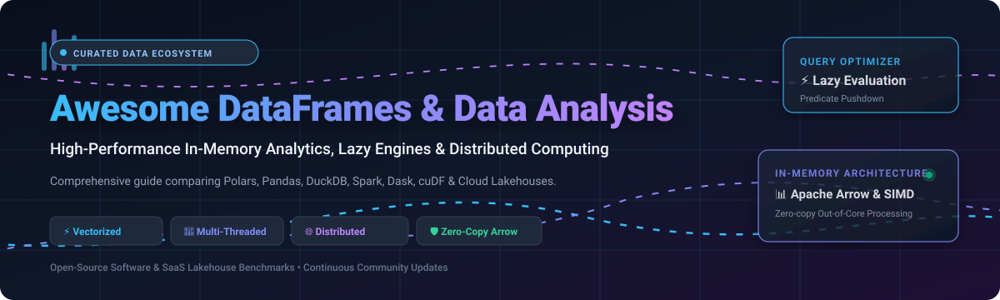
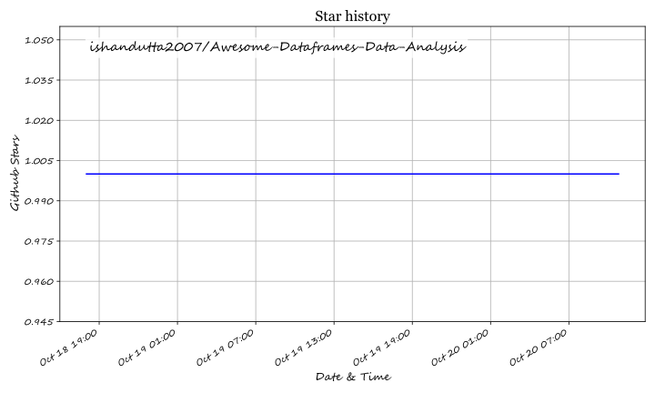

# ⚡ Awesome DataFrames &amp; Data Analysis Ecosystem 📊

**A Curated Catalog of Enterprise SaaS Platforms & High-Performance Open-Source Data Manipulation Engines**

*Engineered for In-Memory Analytics, Vectorized Execution, Lazy Evaluation & Cluster-Scale Distributed Computing*

**Last updated:** October 2026 • **Status:** Active &amp; Community Maintained 🚀

---

## 📖 Table of Contents

- [🌟 Overview](#-overview)
- [📈 Sector Overview & Market Dynamics](#-sector-overview--market-dynamics)
- [☁️ SaaS & Hosted Platforms](#️-saas--hosted-platforms)
- [🐙 Open-Source GitHub Projects](#-open-source-github-projects)
  - [🏆 High-Performance Engines & Ecosystem Leaders](#-high-performance-engines--ecosystem-leaders)
  - [⚡ Distributed, GPU & In-Process Engines](#-distributed-gpu--in-process-engines)
  - [🔬 Foundational Arrays, Toolkits & Compilers](#-foundational-arrays-toolkits--compilers)
- [💡 Architectural Guidance & Decision Matrix](#-architectural-guidance--decision-matrix)
- [🤝 How to Contribute](#-how-to-contribute)
- [💖 Support & Sponsorship](#-support--sponsorship)
- [📊 Star History](#-star-history)
- [⚖️ Disclaimer](#️-disclaimer)

---

## 🌟 Overview

Welcome to the definitive directory of **DataFrames, In-Memory OLAP Engines, and Distributed Analytics Frameworks**. 

Modern data engineering and data science workloads demand extreme throughput—processing millions to billions of rows in milliseconds without prohibitive infrastructure costs. This directory curates tools bridging the gap between single-machine memory constraints and cluster-scale computations:

- **Vectorized & SIMD Execution:** Native C++, Rust, and CUDA acceleration.
- **Lazy Evaluation & Query Optimizers:** Predicate pushdown, projection pruning, and streaming execution plans.
- **Apache Arrow Interoperability:** Zero-copy memory sharing across analytical runtimes.
- **Out-of-Core Processing:** Graceful disk spilling when datasets exceed physical RAM.

---

## 📈 Sector Overview & Market Dynamics

The global **Big Data & Analytical Software Market** is estimated at **~$104B to $143B in 2025–2026**, expanding at a robust **CAGR of ~16%–22%** toward a projected $400B+ by the early 2030s, heavily accelerated by generative AI data preparation and cloud lakehouse adoption.

The sector exhibits **moderate concentration with a bimodal barbell distribution**: the enterprise cloud layer operates as a concentrated oligopoly dominated by hyper-scalers and lakehouse leaders (**Databricks** and **Snowflake**), while the execution engine layer is **dynamic and specialized**, characterized by rapid innovation where modern engines like **Polars**, **DuckDB**, and **Apache Arrow** disrupt legacy single-threaded paradigms.

---

## ☁️ SaaS & Hosted Platforms

| Platform | Description | Valuation / Revenue (Company Size) | Pricing (Starting Tier) | Free Tier / Trial Limits |
| :--- | :--- | :--- | :--- | :--- |
| **[Databricks](https://www.databricks.com)** (Koalas / Pandas API on Spark) | Managed lakehouse platform with distributed pandas execution via Pandas API on Spark. | Valuation: ~$134B (Dec 2025 Series L) / ARR: ~$4.8B+ | $0.15 / DBU (Jobs Compute, Premium Tier) | Free Edition: perpetual serverless access with fair-usage limits (1 small SQL warehouse, no GPU); or 14-day Free Trial with $400 DBU credits |
| **[Snowflake](https://www.snowflake.com)** (Snowpark Python DataFrames) | Enterprise cloud data platform offering native DataFrame APIs via Snowpark Python executed on virtual warehouses. | Market Cap: ~$103B–$130B (Public: NYSE: SNOW) / TTM Revenue: ~$4.7B–$5.4B | $2.00 / credit (Standard Edition, X-Small warehouse = 1 credit/hour) | 30-day Free Trial with $400 in usage credits (no permanent free tier) |
| **[MotherDuck](https://motherduck.com)** | Serverless cloud analytics platform powered by DuckDB with dual-engine hybrid execution. | Valuation: ~$400M / Estimated ARR: ~$12M–$13M | $250.00 / month (Standard / Business Platform base tier) + usage | Free Tier: Forever free for up to 3 users, 10 GB cloud storage, and 10 hours of Pulse compute per month |
| **[Coiled](https://www.coiled.io)** | Managed cloud infrastructure to scale Python and Dask workloads across clusters seamlessly. | Total Funding: ~$26M (Valuation: Undisclosed) / Estimated ARR: ~$5M–$10M | $0.05 / CPU-hour (Basic pay-as-you-go above free tier) | Free Tier: $25 monthly free usage credit allowance (~500 CPU-hours/month) forever, no credit card required |
| **[Polars Cloud](https://pola.rs)** | Managed serverless and distributed compute cloud for Polars DataFrame execution. | Total Funding: ~$25M (Series A €18M, 2025) / Estimated ARR: <$5M | $0.05 / vCPU-hour (Pay-as-you-go beyond free allowance) | Free Tier: 10,000 CPU hours per month free forever (clusters up to 1,024 cores); plus 30-day full-feature trial |

---

## 🐙 Open-Source GitHub Projects

All open-source tools below are strictly sorted in descending order by GitHub stargazers count ⭐:

### 🏆 High-Performance Engines & Ecosystem Leaders

1. **[Pandas](https://github.com/pandas-dev/pandas)**   
   **Flexible and powerful data analysis / manipulation library for Python** (BSD-3-Clause). The ecosystem standard for tabular manipulation in Python. Integrates natively with NumPy, scikit-learn, matplotlib, and PyTorch.  
   *Best for:* General exploratory data analysis (EDA), data cleaning, datasets that fit comfortably in memory (<10M rows).

2. **[Apache Spark](https://github.com/apache/spark)**   
   **Unified analytics engine for large-scale data processing** (Apache-2.0). Provides PySpark and the Pandas API on Spark to scale data pipelines seamlessly across massive compute clusters.  
   *Best for:* Multi-terabyte to petabyte-scale distributed batch ETL and enterprise lakehouses.

3. **[DuckDB](https://github.com/duckdb/duckdb)**   
   **In-process SQL OLAP database management system** (MIT) — often referred to as *"The SQLite for Analytics"*. Features columnar vectorized execution, direct zero-copy querying of Parquet, CSV, and Arrow files, and automated disk spilling.  
   *Best for:* Sub-second analytical SQL scans, aggregations on local files, and serverless analytical data apps without database server overhead.

4. **[Polars](https://github.com/pola-rs/polars)**   
   **Blazingly fast DataFrames library implemented in Rust with Apache Arrow** (MIT). Multi-threaded by default, featuring an advanced query planner with predicate and projection pushdown, streaming out-of-core execution, and expressive Python/Rust/Node.js APIs.  
   *Best for:* Ultra-fast modern data pipelines, datasets larger than physical RAM on single nodes, and migrating bottlenecked Pandas code.

5. **[NumPy](https://github.com/numpy/numpy)**   
   **The fundamental package for scientific computing with Python** (BSD-3-Clause). Introduces the N-dimensional `ndarray` object, linear algebra, Fourier transforms, and universal vectorized operations that underpin the entire Python scientific stack.  
   *Best for:* Homogeneous numeric array operations, matrix mathematics, and foundational numerical computing.

6. **[Apache Arrow](https://github.com/apache/arrow)**   
   **Cross-language development platform for in-memory columnar data** (Apache-2.0). Standardizes zero-copy inter-process communication, vectorized kernels, and columnar formatting across Polars, DuckDB, Spark, and Pandas 2.0+.  
   *Best for:* High-throughput data serialization, polyglot data exchange, and high-performance analytical storage integration.

7. **[SciPy](https://github.com/scipy/scipy)**   
   **Fundamental algorithms for scientific computing in Python** (BSD-3-Clause). Builds upon NumPy to deliver comprehensive algorithms for optimization, numerical integration, differential equations, signal processing, and statistical distributions.  
   *Best for:* Scientific analysis, signal processing, statistical hypothesis testing, and advanced math modeling.

8. **[Dask](https://github.com/dask/dask)**   
   **Flexible library for parallel computing in Python** (BSD-3-Clause). Features `dask.dataframe`, which distributes familiar Pandas operations across multiple CPU cores or multi-node clusters using dynamic task scheduling.  
   *Best for:* Scaling existing Python data workflows beyond single-machine memory without adopting Java/JVM ecosystems.

9. **[Modin](https://github.com/modin-project/modin)**   
   **Scale your Pandas workflows by changing a single line of code** (Apache-2.0). Employs Ray or Dask backends under the hood to automatically parallelize Pandas operations across all available CPU cores.  
   *Best for:* Instant speedups of legacy Pandas notebooks and scripts without refactoring code.

10. **[RAPIDS cuDF](https://github.com/rapidsai/cudf)**   
    **GPU-accelerated DataFrame library based on Apache Arrow** (Apache-2.0). Mimics the Pandas DataFrame API while executing computations on NVIDIA CUDA GPUs for 10x-100x acceleration.  
    *Best for:* Hardware-accelerated ETL, deep learning feature engineering, and massive tabular joins on GPU systems.

### ⚡ Distributed, GPU & In-Process Engines

11. **[Vaex](https://github.com/vaexio/vaex)**   
    **Out-of-Core DataFrames for Python, visualizing and exploring big tabular data** (MIT). Employs memory-mapping (zero memory copy) to calculate statistics, filter, and render billion-row datasets instantaneously.  
    *Best for:* Interactive visualization and exploration of massive Parquet/HDF5 datasets on local laptops.

12. **[Ibis](https://github.com/ibis-project/ibis)**   
    **The Python Dataframe interface to 20+ query engines** (Apache-2.0). Provides a standard Pythonic dataframe syntax that compiles down into SQL or native dialect execution across DuckDB, Snowflake, BigQuery, ClickHouse, and Postgres.  
    *Best for:* Write-once-run-anywhere dataframe pipelines and multi-engine portability.

13. **[Daft](https://github.com/Eventual-Inc/Daft)**   
    **Distributed query engine for multimodal data, written in Rust and Python** (Apache-2.0). Built on Apache Arrow with seamless support for complex multimodal types (images, embeddings, audio, JSON) alongside tabular data.  
    *Best for:* Multimodal data processing, AI data curation, and distributed Arrow compute pipelines.

14. **[GeoPandas](https://github.com/geopandas/geopandas)**   
    **Geographic data tools for Python** (BSD-3-Clause). Extends Pandas data structures to support spatial geometries, spatial joins, and geometric operations powered by Shapely and GDAL/GEOS.  
    *Best for:* Geospatial data analysis, GIS mapping, and coordinates transformation pipelines.

15. **[Databricks Koalas](https://github.com/databricks/koalas)**   
    **Pandas API on Apache Spark** (Apache-2.0). Enables data scientists to remain productive with familiar Pandas semantics while scaling across Apache Spark clusters (now officially integrated into Apache Spark core).  
    *Best for:* Legacy Spark environments and bridging the gap between Pandas data scientists and Spark clusters.

16. **[Fugue](https://github.com/fugue-project/fugue)**   
    **A unified interface for distributed computing** (Apache-2.0). Seamlessly port native Python and Pandas code to Spark, Dask, and Ray without platform-specific boilerplate.  
    *Best for:* Cross-engine abstraction, seamless testing on local Pandas before deploying to Spark/Ray.

17. **[Datatable](https://github.com/h2oai/datatable)**   
    **Data manipulation at scale for Python** (MPL-2.0). C-based multi-threaded data manipulation library inspired by R's `data.table`, prioritizing fast data ingestion, grouping, and memory efficiency.  
    *Best for:* Machine learning feature preprocessing and fast columnar operations on single nodes.

18. **[Narwhals](https://github.com/narwhals-dev/narwhals)**   
    **Lightweight, zero-dependency compatibility layer between dataframe libraries** (MIT). Enables library maintainers to support Polars, Pandas, Modin, cuDF, and PyArrow simultaneously with zero performance overhead.  
    *Best for:* Python data tooling authors building backend-agnostic dataframe plugins and libraries.

---

## 💡 Architectural Guidance & Decision Matrix

| Dimension | **Pandas** | **Polars** | **DuckDB** | **Dask** | **PySpark** |
| :--- | :--- | :--- | :--- | :--- | :--- |
| **Execution Model** | Eager (In-Memory) | Lazy &amp; Streaming | Vectorized SQL / OLAP | Lazy DAG (Task Graph) | Distributed DAG |
| **Concurrency** | Single-threaded | Multi-threaded (Rust) | Multi-threaded (C++) | Multi-core / Cluster | Distributed Cluster |
| **Data Format** | NumPy / Arrow | Apache Arrow | Columnar Native / Arrow | Partitioned Pandas | JVM RDD / Arrow |
| **Memory Limit** | Strict Physical RAM | Disk Spilling Streaming | Automated Disk Spilling | Out-of-Core Disk Spilling | Cluster Storage / HDFS / S3 |
| **Primary Interface** | Python DataFrame | Python/Rust/JS API | SQL + Python Relational | Python DataFrame | PySpark DataFrame / SQL |
| **Best Sweetspot** | < 10 Million Rows | Single Node (Up to ~500M) | Local SQL Analytics | Medium Distributed Cluster | Massive Enterprise Scale |

---

## 🤝 How to Contribute

We welcome community contributions, performance benchmarks, and new engine submissions!

1. 🍴 **Fork the repository** to your personal GitHub account.
2. 🌿 **Create a descriptive branch:** `git checkout -b feature/add-new-engine`.
3. 📝 **Add or update entries in `README.md`:** Ensure descriptions remain factual, include repository links, and follow existing star-badge conventions.
4. ✅ **Ensure accuracy:** Validate licenses, pricing models, and categorization.
5. 🚀 **Submit a Pull Request** with a concise explanation of your changes.

---

## 💖 Support & Sponsorship

If this curated ecosystem helps optimize your data pipelines, benchmark your analytical workflows, or streamline your infrastructure choices, please consider supporting the project!

- 🌟 **Star this repository** to help others discover it.
- 🔀 **Fork and share** with colleagues and data teams.
- ☕ **Sponsor or buy a coffee:** Support ongoing research and maintenance via the [GitHub Sponsor Dashboard](https://github.com/sponsors/ishandutta2007).

---

## 📊 Star History

---

## ⚖️ Disclaimer

- This is a **community-curated index** — provided for educational and architectural reference only, not an official vendor endorsement.
- All benchmark metrics, feature representations, and company valuations are tracked based on public filings and community releases as of October 2026.
- Production systems handling sensitive data must independently audit compliance with relevant regulations (GDPR, HIPAA, CCPA) and verify access controls.

---

**Crafted with ❤️ for data scientists, analytics engineers, and data infrastructure builders worldwide.**

Let's make DataFrames & Data Analysis faster, leaner, and more scalable! 🚀

## ⭐ Star History

<a href="https://star-history.com/#ishandutta2007/Awesome-Dataframes-Data-Analysis&Timeline" align="center">
  <picture>
    <source media="(prefers-color-scheme: dark)" srcset="assets/ishandutta2007_Awesome-Dataframes-Data-Analysis_growth.svg">
    
  </picture>
</a>
